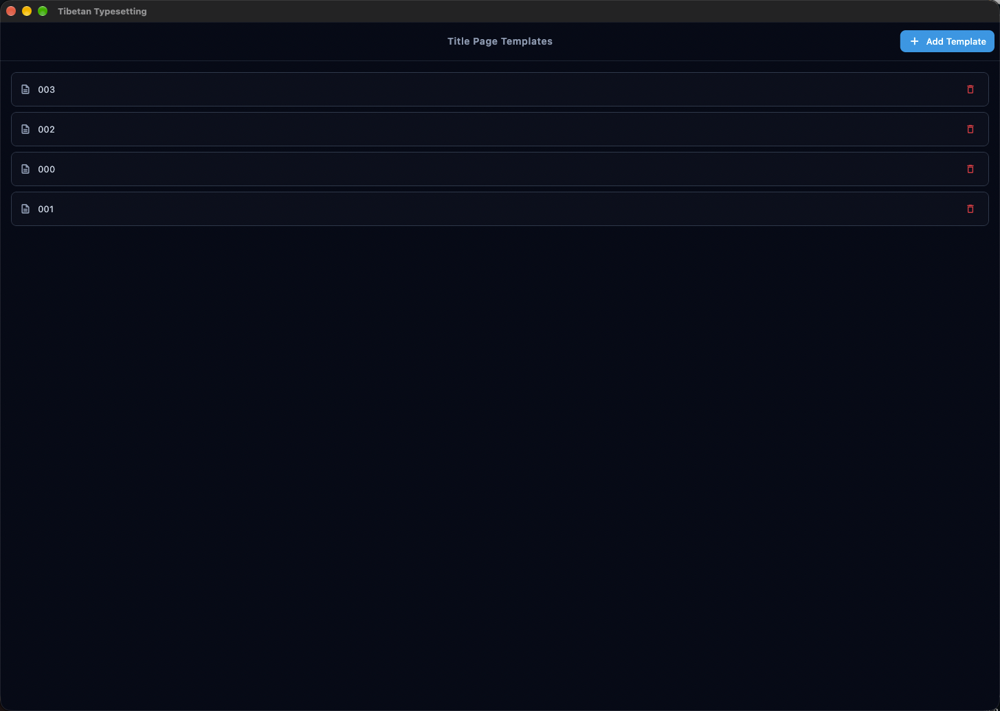

# Tibetan Typesetting

[繁體中文](README.zh-TW.md) | English &nbsp;·&nbsp; **v1.1.16**

<p align="center">
  
</p>

A Flutter desktop application for creating and exporting Tibetan text documents with translations in a traditional layout format.


## Features

### 📝 Rich Text Editing
- Create and manage multiple Tibetan text projects
- Organize content into blocks with:
  - Tibetan text (with heading and free-text format support)
  - Chinese pronunciation (phonetic transcription)
  - Translation (Chinese, English, Japanese, or custom language)
- Visual block navigation and management
- Auto-save functionality with save-state indicator
- Undo/Redo support (up to 50 states)
- Red character highlight — mark selected words in heading text with red ink using range notation (e.g. `1-4,6-8`) while vowel marks, tshegs, and punctuation remain black
- Red opening mark — render an opening-mark block entirely in red ink (including shad punctuation) with a checkbox in the block editor
- **Chinese script switch** — convert all Chinese text in a project between Simplified and Traditional with one click; script is auto-detected from content when unset

### 🧭 Workspace Navigation
- Left sidebar with Projects, Dictionary, Templates, and Settings destinations
- Recent-projects list opens the editor directly
- Projects, dictionary, templates, and settings share one workspace shell

### 🖼️ Floating Images
- Insert images into text blocks with precise positioning
- Configurable image dimensions (width/height in mm)
- Drag-to-position images with X/Y coordinates
- Toggle between inline and floating image modes
- Images stored locally in app support directory

### 📥 Batch Import
- Import text blocks from CSV or TSV files
- Automatic delimiter detection (tab or comma)
- Import summary with row counts and warnings
- Bulk-add large amounts of content at once

### 🔤 Pronunciation Dictionary
- Local syllable-level Tibetan-to-Chinese pronunciation dictionary
- Auto-fills Chinese pronunciation as you type Tibetan text
- Unknown syllables are highlighted in yellow in the Tibetan field and shown as `X` in the pronunciation field
- Pronunciation entries are auto-saved to the dictionary when you type
- Supports multi-character pronunciations for abbreviated syllables (e.g. པདྨ → 2 characters)
- Dictionary management page with search, edit, and delete
- Export and import dictionary as JSON for sharing


### 📄 Traditional Layout
- Traditional Tibetan book layout (landscape orientation)
- Configurable page dimensions and margins
- Multi-column layout support (1-8 columns)
- Per-block column span control
- Page and column break controls
- Flow gap adjustment between text sections
- Custom title page with Dharma Wheel symbol and configurable title fonts
- **Custom SVG title page templates** managed from the Templates page and rendered as true vector graphics in PDF, with configurable insets for template and title text regions
- **Content page templates** — apply an SVG background template to all content pages with configurable export margins
- Opening mark blocks at the start of content
- Optional row separator lines in editor preview and PDF export, with a configurable Y offset
- Configurable small block font size — independently adjust font size for compact ("small text") blocks in app settings and per-project font settings
- **Tibetan–Chinese spacing** — configurable gap between Tibetan and Chinese lines for both the title page and content, in px; negative values overlap the lines
- Flexible text sizing options with per-project font settings
- Template cards show live SVG previews on the Templates page for faster management
- Header and footer with configurable fields (file name, page number, date, custom text)

### 🖨️ PDF & HTML Export
- High-quality PDF generation with proper Tibetan script rendering and vector SVG title page templates
- Missing-glyph fallback in preview and PDF — rare characters render through system/shaper fallbacks instead of disappearing
- HTML export for web viewing
- Live preview with zoom controls before export
- Print directly from the app
- Share or save PDF files
- Proper handling of complex Tibetan OpenType features
- Configurable PDF export settings


## Technical Highlights

### Tibetan Script Rendering
Tibetan text is embedded in the PDF as **vector glyph outlines**, not images:
- Tibetan needs OpenType GSUB/GPOS shaping (stacked consonants, vowel-sign positioning), which the `pdf` package does not implement, so text is shaped with HarfBuzz (`harfbuzz_ffi`) via Dart FFI
- Each shaped glyph is drawn as a PDF path and stored once as a reusable form XObject, so repeated syllables do not inflate the file (a 40-block document is ~140 KB instead of ~4 MB with inline paths)
- An invisible Unicode text layer is emitted alongside the outlines, so exported PDFs stay searchable, copyable and accessible
- Line breaking and line metrics match Flutter's `TextPainter`, keeping the export aligned with the on-screen preview
- Chinese and free-text blocks still use native PDF text with CJK fallback fonts

### DPI-Aware Preview
- `ScreenDpiService` queries the actual physical screen DPI via a native platform channel
- The editor and export previews scale content to match the real physical size of the exported PDF
- Ensures font sizes and row heights in the preview match the final printed output

### Data Persistence
- SQLite database for reliable local storage
- Projects stored as JSON with indexed metadata
- Support for project import/export (JSON)
- Project duplication and tagging
- Image files stored in application support directory
- **Selectable database location** — choose a custom folder for the database file and persist the choice across launches via security-scoped bookmarks
- **Database recovery page** — guides the user through retry, choose another file, or reset to default when the database cannot be opened

## Getting Started

### Prerequisites
- Flutter SDK (^3.11.0)
- Desktop platform support (macOS, Windows, or Linux)

### Installation

1. Clone the repository:
```bash
git clone <repository-url>
cd tibetan_typesetting
```

2. Install dependencies:
```bash
flutter pub get
```

3. Run the application:
```bash
flutter run
```

### Font Requirements

The application uses system fonts:
- **Tibetan**: BabelStoneTibetan (or other Tibetan Unicode fonts)
- **Chinese**: STHeiti (typically pre-installed on macOS)

Fonts can be configured per-project through the font settings panel. Make sure required fonts are installed on your system for proper text rendering.

## Usage

1. **Create a Project**: Start from the workspace; the left sidebar switches between Projects, Dictionary, Templates, and Settings. Create a new project (optionally selecting a custom title page template)
2. **Add Content**: Add text blocks with Tibetan text, pronunciation, and translation
3. **Pronunciation Auto-fill**: The editor auto-fills pronunciation from the dictionary as you type; unknown syllables are highlighted and shown as `X`
4. **Red Highlight**: Enter a range (e.g. `1-4,6`) in the block's highlight field to render selected heading words in red ink in both preview and PDF
5. **Insert Images**: Add floating images to blocks with position and size control
6. **Batch Import**: Import multiple text blocks at once from CSV/TSV files
7. **Edit Layout**: Configure page setup, margins, column count, flow gap, row lines, and headers/footers
8. **Title Page Templates**: Open the Templates page from the sidebar, upload SVG templates, then assign them per project with configurable insets
9. **Content Page Templates**: Assign an SVG background to all content pages with configurable export margins
10. **Font Settings**: Customize fonts per-project for Tibetan, pronunciation, translation, title text, and small block size
11. **Preview**: View live DPI-accurate preview with zoom controls of your document layout
12. **Export**: Generate PDF, export HTML, or print directly from the app
13. **Manage Dictionary**: Open the Pronunciation Dictionary from the sidebar to view, search, edit, or delete saved syllable entries and export/import the dictionary as JSON




## Project Structure

```
lib/
├── main.dart                       # Application entry point
├── l10n/                            # Localization (en, zh, zh_TW)
│   ├── app_en.arb                  # English translations
│   ├── app_zh.arb                  # Simplified Chinese translations
│   ├── app_zh_TW.arb              # Traditional Chinese translations
│   └── app_localizations.dart      # Generated localization classes
├── models/                          # Data models
│   ├── project.dart                # Project, TextBlock, PageSetup, MarginMm
│   ├── block_update.dart           # Block update descriptor
│   ├── app_settings.dart           # Application settings
│   ├── chinese_script.dart         # ChineseScript enum (simplified/traditional/unknown)
│   ├── font_config.dart            # Font configuration
│   ├── pronunciation_entry.dart    # Pronunciation dictionary entry
│   └── title_page_template.dart    # Title page template model
├── pages/                           # Main application pages
│   ├── projects_page.dart          # Project management
│   ├── database_recovery_page.dart # Database open failure recovery
│   ├── editor_page.dart            # Text editor
│   ├── export_page.dart            # PDF/HTML export and preview
│   ├── settings_page.dart          # Application settings
│   ├── templates_page.dart         # Title page template management
│   └── dictionary_page.dart        # Pronunciation dictionary management
├── services/                        # Business logic
│   ├── chinese_conversion_service.dart  # Simplified ↔ Traditional Chinese conversion
│   ├── database_bookmark_service.dart   # Security-scoped bookmark persistence
│   ├── database_file_validator.dart     # Database file integrity checks
│   ├── database_location_core.dart      # Pure database location resolution logic
│   ├── database_location_provider.dart  # Database location dependency provider
│   ├── database_location_service.dart   # Database location selection and startup
│   ├── database_service.dart       # SQLite persistence
│   ├── database_service_core.dart  # Pure database query logic
│   ├── database_startup_controller.dart # Startup resolution and recovery flow
│   ├── pdf_service.dart            # PDF generation
│   ├── pdf_service_core.dart       # Pure PDF rendering helpers
│   ├── html_export_service.dart    # HTML export generation
│   ├── font_service.dart           # Font management
│   ├── font_service_core.dart      # Pure font discovery logic
│   ├── settings_service.dart       # Settings management
│   ├── pronunciation_service.dart  # Pronunciation dictionary CRUD
│   ├── batch_import_service.dart   # CSV/TSV batch import
│   ├── undo_service.dart           # Undo/Redo state management
│   ├── image_cache_service.dart    # Rendered text image caching
│   ├── image_storage_service.dart  # Block image file storage
│   ├── screen_dpi_service.dart     # Physical screen DPI for accurate preview
│   └── title_page_template_service.dart # Title page template CRUD
├── utils/                           # Utilities
│   ├── colors.dart                 # Color palette
│   ├── content_page_template_layout.dart # Content page template geometry
│   ├── decorations.dart            # Input decoration helpers
│   ├── font_constants.dart         # Default font constants
│   ├── sample_layout.dart          # Pagination logic
│   ├── text_renderer.dart          # Text to image rendering
│   ├── font_utils.dart             # Font utilities
│   ├── tibetan_segmenter.dart      # Tsheg-based syllable/range extraction
│   ├── save_state_mixin.dart       # Save state UI mixin
│   ├── snackbar.dart               # SnackBar helper
│   └── title_page_layout.dart      # Title page template layout utilities
└── widgets/                         # Reusable UI components
    ├── app_shell.dart               # Common scaffold
    ├── block_editor.dart            # Block editing panel
    ├── block_strip.dart             # Block navigation
    ├── chinese_script_switch.dart   # Simplified/Traditional toggle
    ├── content_page_template_panel.dart # Content page template controls
    ├── database_location_panel.dart # Database location settings
    ├── editor_page_setup_panel.dart # Page setup controls
    ├── export_pdf_settings_panel.dart # PDF export settings
    ├── flow_spacing_panel.dart      # Flow gap controls
    ├── font_picker.dart             # Font selection widget
    ├── font_settings_panel.dart     # Per-project font settings
    ├── preview_zoom_toolbar.dart    # Preview zoom controls
    ├── project_card.dart            # Project list card
    ├── sample_page.dart             # Page preview
    ├── sample_pages.dart            # Multi-page preview
    ├── scaled_preview.dart          # Scaled preview wrapper
    ├── settings_controls.dart       # Shared compact settings controls
    ├── text_field_dialog.dart       # Shared single-field dialog
    ├── title_page_settings_panel.dart # Title page configuration
    ├── title_page_widget.dart       # Title page preview
    ├── workspace_shell.dart         # Workspace root (sidebar + page)
    └── workspace_sidebar.dart       # Workspace navigation rail
```

## Development

### Code Analysis
```bash
flutter analyze
```

### Running Tests
```bash
flutter test
```

### Building for Release

**macOS:**
```bash
flutter build macos
```

**Windows:**
```bash
flutter build windows
```

**Linux:**
```bash
flutter build linux
```

## Architecture

### Key Components

- **DatabaseService**: Singleton managing SQLite operations for project persistence
- **DatabaseLocationService**: Selectable database location with security-scoped bookmark persistence and startup resolution
- **DatabaseStartupController**: Guides the app through database open failures and recovery flows
- **ChineseConversionService**: Converts all Chinese text in a project between Simplified and Traditional; auto-detects script from content
- **PdfService**: Singleton handling PDF generation with Tibetan text pre-rendering
- **HtmlExportService**: Generates standalone HTML documents from projects
- **FontService**: System font discovery and management
- **SettingsService**: Application settings persistence
- **PronunciationService**: Singleton CRUD service for the local pronunciation dictionary
- **BatchImportService**: Parses CSV/TSV files into text blocks
- **UndoService**: Manages undo/redo state stack (max 50 states)
- **ImageCacheService**: SHA-256 keyed cache for rendered text images
- **ImageStorageService**: Manages block image files in app support directory
- **ScreenDpiService**: Queries physical screen DPI via platform channel for accurate preview scaling
- **TitlePageTemplateService**: CRUD singleton for custom SVG title page templates
- **TibetanSegmenter**: Splits Tibetan text into syllables by tsheg (་); parses range notation for red highlight
- **WorkspaceShell / WorkspaceSidebar**: Root workspace combining the navigation rail (Projects, Dictionary, Templates, Settings) with the selected page

### Page Layout Algorithm

The `sample_layout.dart` utility implements a two-pass pagination system:
1. Organizes blocks into rows based on column count
2. Distributes rows across pages respecting break flags
3. Handles page and column break controls
4. Supports per-block column spanning and flow gap spacing

### Text Rendering Pipeline

**Tibetan** (`lib/utils/shaped_text_pdf.dart`):
1. HarfBuzz shapes each font-coverage run, applying GSUB/GPOS
2. Greedy line filling breaks only after whitespace, tsheg/shad, or between CJK characters — never inside a syllable
3. Every glyph outline is cached as a form XObject in font units
4. Glyphs are drawn with `drawXObject` at the target size, plus an invisible Unicode text layer for search/copy

**Chinese, side panels and free text** are real PDF text:
1. Embedded as a subset TrueType font, with CJK fallback fonts for glyph gaps
2. `wordSpacing` is forced to `0` for CJK and `lineSpacing` is derived per font so the baseline advance equals `fontSize × lineHeight`, matching the preview and the layout engine
3. No text is ever rasterised — only images the user inserts are embedded as images

## License

This project is licensed under the GNU General Public License v2.0 - see the [LICENSE](LICENSE) file for details.

## Contributing

Contributions are welcome! Please feel free to submit issues or pull requests.

## Acknowledgments

- Built with [Flutter](https://flutter.dev/)
- Uses [BabelStoneTibetan](https://www.babelstone.co.uk/Fonts/Tibetan.html) font for Tibetan script
- PDF generation powered by the [pdf](https://pub.dev/packages/pdf) package
