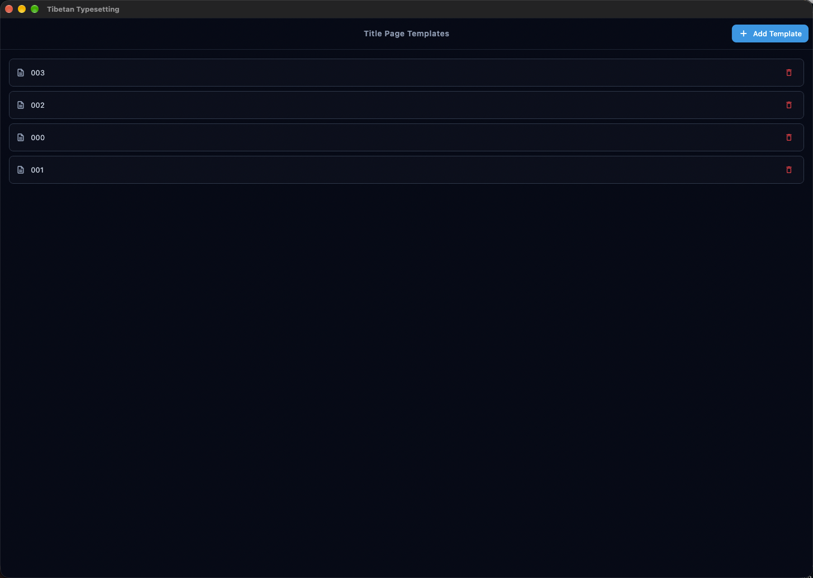

# 藏文排版 &nbsp;·&nbsp; v1.1.15

[English](README.md) | 繁體中文

<p align="center">
  
</p>

一個用於創建和匯出藏文文檔的 Flutter 桌面應用程式，採用傳統排版格式並包含翻譯。


## 功能特色

### 📝 豐富的文字編輯
- 創建和管理多個藏文文檔專案
- 將內容組織為文字區塊，包含：
  - 藏文文字（支援標題和自由文字格式）
  - 中文讀音（音標轉寫）
  - 翻譯（中文、英文、日文或自訂語言）
- 視覺化的區塊導航和管理
- 自動儲存功能及儲存狀態指示器
- 復原/重做支援（最多 50 個狀態）
- 紅色字元強調 — 使用範圍標記（如 `1-4,6-8`）將標題中選定的詞語以紅字標示，母音符號、tsheg 和標點保持黑色
- 紅色卷首標記 — 在段落編輯器中勾選即可將卷首標記整段顯示為紅色（包含標點）
- **中文字體切換** — 一鍵將專案內所有中文文字在繁體與簡體之間相互轉換；未設定時自動從內容偵測字體

### 🧭 工作區導覽
- 左側邊欄提供專案、詞典、範本與設定四個目的地
- 最近專案清單可直接開啟編輯器
- 專案、詞典、範本與設定共用同一個工作區外殼

### 🖼️ 浮動圖片
- 在文字區塊中插入圖片並精確定位
- 可設定圖片尺寸（寬度/高度，單位 mm）
- 拖曳定位圖片的 X/Y 座標
- 切換內嵌和浮動圖片模式
- 圖片儲存於應用程式支援目錄

### 📥 批次匯入
- 從 CSV 或 TSV 檔案匯入文字區塊
- 自動偵測分隔符號（定位點或逗號）
- 匯入摘要顯示列數和警告
- 一次大量新增內容

### 🔤 讀音詞典
- 本地音節級藏文轉中文讀音詞典
- 輸入藏文時自動填入中文讀音
- 未知音節在藏文欄位以黃色高亮顯示，在讀音欄位顯示為 `X`
- 輸入讀音時自動儲存至詞典
- 支援縮寫音節的多字讀音設定（例如 པདྨ → 2 個中文字）
- 詞典管理頁面，支援搜尋、編輯和刪除
- 支援將詞典匯出／匯入為 JSON 格式以便分享


### 📄 傳統排版格式
- 傳統藏文書籍排版（橫向方向）
- 可自訂的頁面尺寸和邊距
- 多欄排版支援（1-8 欄）
- 每區塊欄位跨欄控制
- 分頁和分欄控制
- 文字流間距調整
- 自訂封面頁，帶有法輪符號及可設定標題字型
- **自訂 SVG 封面頁模板** — 從範本頁面管理，以純向量圖形嵌入 PDF，支援模板和標題文字區域的可設定內縮距離
- **內容頁模板** — 為所有內容頁套用 SVG 背景模板，可設定匯出邊距
- 內容起始的開頭標記區塊
- 編輯器預覽和 PDF 匯出中的可選列分隔線
- 可設定的「小字」字型大小 — 在應用設定與各專案字型設定中獨立調整緊湊區塊的字型大小
- **藏文與中文間距** — 可設定封面頁與內容的藏文、中文行距（單位 px）；負值可讓兩行重疊
- 彈性的文字大小選項，支援每專案字型設定
- 頁首和頁尾，可設定欄位（檔案名稱、頁碼、日期、自訂文字）

### 🖨️ PDF 與 HTML 匯出
- 高品質的 PDF 生成，完美呈現藏文字型，封面頁 SVG 模板以向量圖形嵌入
- HTML 匯出供網頁檢視
- 匯出前即時預覽，支援縮放控制
- 直接從應用程式列印
- 分享或儲存 PDF 檔案
- 正確處理複雜的藏文 OpenType 功能
- 可設定的 PDF 匯出設定


## 技術亮點

### 藏文字型渲染
PDF 中的藏文以**向量字形輪廓**嵌入，而非圖片：
- `pdf` 套件不實作 OpenType GSUB/GPOS 塑形，因此改用 HarfBuzz（`harfbuzz_ffi`，透過 Dart FFI）塑形
- 每個字形以 PDF 路徑繪製，並只儲存一份可重用的 form XObject，重複的音節不會膨脹檔案（40 個區塊的文件約 140 KB，若逐字內嵌則約 4 MB）
- 同時輸出一層隱形的 Unicode 文字，使匯出的 PDF 仍可搜尋、複製與無障礙讀取
- 換行位置與行高與 Flutter 的 `TextPainter` 完全一致，匯出結果與畫面預覽對齊
- 中文與自由文字區塊仍使用 PDF 原生文字搭配 CJK 備援字型

### DPI 感知預覽
- `ScreenDpiService` 透過原生平台通道查詢實體螢幕 DPI
- 編輯器和匯出預覽會依實體螢幕縮放，與匯出 PDF 的物理尺寸一致
- 確保預覽中的字型大小和列高與最終列印輸出相符

### 資料持久化
- 使用 SQLite 資料庫進行可靠的本地儲存
- 專案以 JSON 格式儲存，並建立索引的中繼資料
- 支援專案匯入/匯出（JSON）
- 專案複製和標籤功能
- 圖片檔案儲存於應用程式支援目錄
- **可選擇資料庫位置** — 自訂資料庫檔案的儲存資料夾，並透過安全範圍書籤在啟動時持續保留選擇
- **資料庫還原頁面** — 當資料庫無法開啟時，引導使用者重試、選擇其他檔案或重設為預設值

## 開始使用

### 系統需求
- Flutter SDK (^3.11.0)
- 桌面平台支援（macOS、Windows 或 Linux）

### 安裝

1. 複製儲存庫：
```bash
git clone <repository-url>
cd tibetan_typesetting
```

2. 安裝相依套件：
```bash
flutter pub get
```

3. 執行應用程式：
```bash
flutter run
```

### 字型需求

應用程式使用系統字型：
- **藏文**：BabelStoneTibetan（或其他藏文 Unicode 字型）
- **中文**：STHeiti（通常在 macOS 上預先安裝）

字型可透過字型設定面板依專案設定。請確保所需字型已安裝在您的系統上，以正確顯示文字。

## 使用方式

1. **創建專案**：從工作區開始；左側邊欄可在專案、詞典、範本與設定之間切換。創建新專案（可選擇自訂封面頁模板）
2. **新增內容**：新增包含藏文文字、讀音和翻譯的文字區塊
3. **讀音自動填入**：輸入藏文時，編輯器會自動從詞典填入讀音；未知音節以高亮和 `X` 標示
4. **紅色強調**：在區塊的強調欄位輸入範圍（如 `1-4,6`），讓標題中選定的詞語在預覽和 PDF 中以紅字顯示
5. **插入圖片**：在區塊中新增浮動圖片，可控制位置和尺寸
6. **批次匯入**：從 CSV/TSV 檔案一次匯入多個文字區塊
7. **編輯排版**：設定頁面設定、邊距、欄數、流間距、列分隔線和頁首頁尾
8. **封面頁模板**：從側邊欄開啟範本頁面，上傳 SVG 模板，然後依專案指定並設定內縮距離
9. **內容頁模板**：為所有內容頁指定 SVG 背景，並設定匯出邊距
10. **字型設定**：依專案自訂藏文、讀音、翻譯、標題文字及小字區塊大小的字型
11. **預覽**：使用縮放控制即時查看 DPI 精確的文檔排版預覽
12. **匯出**：生成 PDF、匯出 HTML 或直接從應用程式列印
13. **管理詞典**：從側邊欄開啟讀音詞典，檢視、搜尋、編輯或刪除已儲存的音節項目，並可匯出／匯入 JSON




## 專案結構

```
lib/
├── main.dart                       # 應用程式進入點
├── l10n/                            # 本地化（en、zh、zh_TW）
│   ├── app_en.arb                  # 英文翻譯
│   ├── app_zh.arb                  # 簡體中文翻譯
│   ├── app_zh_TW.arb              # 繁體中文翻譯
│   └── app_localizations.dart      # 產生的本地化類別
├── models/                          # 資料模型
│   ├── project.dart                # Project、TextBlock、PageSetup、MarginMm
│   ├── block_update.dart           # 區塊更新描述器
│   ├── app_settings.dart           # 應用程式設定
│   ├── chinese_script.dart         # ChineseScript 列舉（簡體/繁體/未知）
│   ├── font_config.dart            # 字型設定
│   ├── pronunciation_entry.dart    # 讀音詞典項目
│   └── title_page_template.dart    # 封面頁模板模型
├── pages/                           # 主要應用程式頁面
│   ├── projects_page.dart          # 專案管理
│   ├── database_recovery_page.dart # 資料庫開啟失敗還原
│   ├── editor_page.dart            # 文字編輯器
│   ├── export_page.dart            # PDF/HTML 匯出和預覽
│   ├── settings_page.dart          # 應用程式設定
│   ├── templates_page.dart         # 封面頁模板管理
│   └── dictionary_page.dart        # 讀音詞典管理
├── services/                        # 業務邏輯
│   ├── chinese_conversion_service.dart  # 簡繁中文相互轉換
│   ├── database_bookmark_service.dart   # 安全範圍書籤持久化
│   ├── database_file_validator.dart     # 資料庫檔案完整性驗證
│   ├── database_location_core.dart      # 純資料庫位置解析邏輯
│   ├── database_location_provider.dart  # 資料庫位置相依提供者
│   ├── database_location_service.dart   # 資料庫位置選擇與啟動
│   ├── database_service.dart       # SQLite 持久化
│   ├── database_service_core.dart  # 純資料庫查詢邏輯
│   ├── database_startup_controller.dart # 啟動解析與還原流程
│   ├── pdf_service.dart            # PDF 生成
│   ├── pdf_service_core.dart       # 純 PDF 渲染輔助
│   ├── html_export_service.dart    # HTML 匯出生成
│   ├── font_service.dart           # 字型管理
│   ├── font_service_core.dart      # 純字型探索邏輯
│   ├── settings_service.dart       # 設定管理
│   ├── pronunciation_service.dart  # 讀音詞典 CRUD
│   ├── batch_import_service.dart   # CSV/TSV 批次匯入
│   ├── undo_service.dart           # 復原/重做狀態管理
│   ├── image_cache_service.dart    # 渲染文字圖片快取
│   ├── image_storage_service.dart  # 區塊圖片檔案儲存
│   ├── screen_dpi_service.dart     # 實體螢幕 DPI（用於精確預覽縮放）
│   └── title_page_template_service.dart # 封面頁模板 CRUD
├── utils/                           # 工具程式
│   ├── colors.dart                 # 色彩配置
│   ├── content_page_template_layout.dart # 內容頁模板幾何工具
│   ├── decorations.dart            # 輸入裝飾輔助
│   ├── font_constants.dart         # 預設字型常數
│   ├── sample_layout.dart          # 分頁邏輯
│   ├── text_renderer.dart          # 文字轉圖片渲染
│   ├── font_utils.dart             # 字型工具
│   ├── tibetan_segmenter.dart      # 藏文音節切分與範圍標記解析
│   ├── save_state_mixin.dart       # 儲存狀態 UI mixin
│   ├── snackbar.dart               # SnackBar 輔助
│   └── title_page_layout.dart      # 封面頁模板排版工具
└── widgets/                         # 可重複使用的 UI 元件
    ├── app_shell.dart               # 通用架構
    ├── block_editor.dart            # 區塊編輯面板
    ├── block_strip.dart             # 區塊導航
    ├── chinese_script_switch.dart   # 簡體/繁體切換
    ├── content_page_template_panel.dart # 內容頁模板控制
    ├── database_location_panel.dart # 資料庫位置設定
    ├── editor_page_setup_panel.dart # 頁面設定控制
    ├── export_pdf_settings_panel.dart # PDF 匯出設定
    ├── flow_spacing_panel.dart      # 流間距控制
    ├── font_picker.dart             # 字型選擇器
    ├── font_settings_panel.dart     # 每專案字型設定
    ├── preview_zoom_toolbar.dart    # 預覽縮放控制
    ├── project_card.dart            # 專案列表卡片
    ├── sample_page.dart             # 頁面預覽
    ├── sample_pages.dart            # 多頁面預覽
    ├── scaled_preview.dart          # 縮放預覽包裝器
    ├── settings_controls.dart       # 共用精簡設定控制項
    ├── text_field_dialog.dart       # 共用單欄位對話框
    ├── title_page_settings_panel.dart # 封面頁設定
    ├── title_page_widget.dart       # 封面頁預覽
    ├── workspace_shell.dart         # 工作區根層（側邊欄 + 頁面）
    └── workspace_sidebar.dart       # 工作區導覽側邊欄
```

## 開發

### 程式碼分析
```bash
flutter analyze
```

### 執行測試
```bash
flutter test
```

### 建置發佈版本

**macOS:**
```bash
flutter build macos
```

**Windows:**
```bash
flutter build windows
```

**Linux:**
```bash
flutter build linux
```

## 架構

### 核心元件

- **DatabaseService**：管理 SQLite 操作的單例服務，用於專案持久化
- **DatabaseLocationService**：可選擇的資料庫位置，透過安全範圍書籤持久化並在啟動時解析
- **DatabaseStartupController**：引導應用程式完成資料庫開啟失敗的還原流程
- **ChineseConversionService**：將專案內所有中文在簡體與繁體之間轉換；自動從內容偵測字體
- **PdfService**：處理 PDF 生成的單例服務，包含藏文文字預渲染
- **HtmlExportService**：從專案產生獨立 HTML 文件
- **FontService**：系統字型探測和管理
- **SettingsService**：應用程式設定持久化
- **PronunciationService**：本地讀音詞典的 CRUD 單例服務
- **BatchImportService**：解析 CSV/TSV 檔案為文字區塊
- **UndoService**：管理復原/重做狀態堆疊（最多 50 個狀態）
- **ImageCacheService**：基於 SHA-256 金鑰的渲染文字圖片快取
- **ImageStorageService**：管理應用程式支援目錄中的區塊圖片檔案
- **ScreenDpiService**：透過平台通道查詢實體螢幕 DPI，用於精確的預覽縮放
- **TitlePageTemplateService**：自訂 SVG 封面頁模板的 CRUD 單例服務
- **TibetanSegmenter**：藏文音節切分工具，基於 tsheg（་）分割；解析紅字範圍標記
- **WorkspaceShell / WorkspaceSidebar**：工作區根層，結合導覽側邊欄（專案、詞典、範本、設定）與目前頁面

### 頁面排版演算法

`sample_layout.dart` 工具實作了兩階段分頁系統：
1. 根據欄數將區塊組織為列
2. 將列分配到各頁面，遵循分隔標記
3. 處理分頁和分欄控制
4. 支援每區塊跨欄和流間距

### 文字渲染流程

**藏文**（`lib/utils/shaped_text_pdf.dart`）：
1. HarfBuzz 依字型涵蓋範圍切段並塑形，套用 GSUB/GPOS
2. 貪婪換行只在空白、音節點（tsheg）、隔符（shad）之後或 CJK 字元之間斷行，絕不切開音節
3. 每個字形輪廓以字型單位快取為 form XObject
4. 以 `drawXObject` 縮放繪製，並疊加隱形 Unicode 文字層供搜尋／複製

**中文、側邊欄與自由文字**都是 PDF 原生文字：
1. 以子集化的 TrueType 字型嵌入，缺字時使用 CJK 備援字型
2. CJK 的 `wordSpacing` 強制為 `0`，並依字型推算 `lineSpacing`，使基線間距等於 `fontSize × lineHeight`，與預覽及排版引擎一致
3. 文字一律不轉為圖片——只有使用者插入的圖片才以圖片嵌入

## 授權條款

本專案採用 GNU 通用公共授權條款 2.0 版授權 - 詳見 [LICENSE](LICENSE) 檔案。

## 貢獻

歡迎貢獻！請隨時提交問題或拉取請求。

## 致謝

- 使用 [Flutter](https://flutter.dev/) 建置
- 使用 [BabelStoneTibetan](https://www.babelstone.co.uk/Fonts/Tibetan.html) 字型顯示藏文字型
- PDF 生成由 [pdf](https://pub.dev/packages/pdf) 套件提供支援
